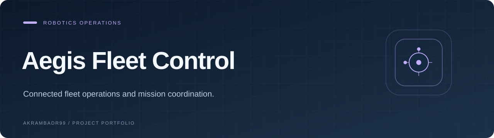
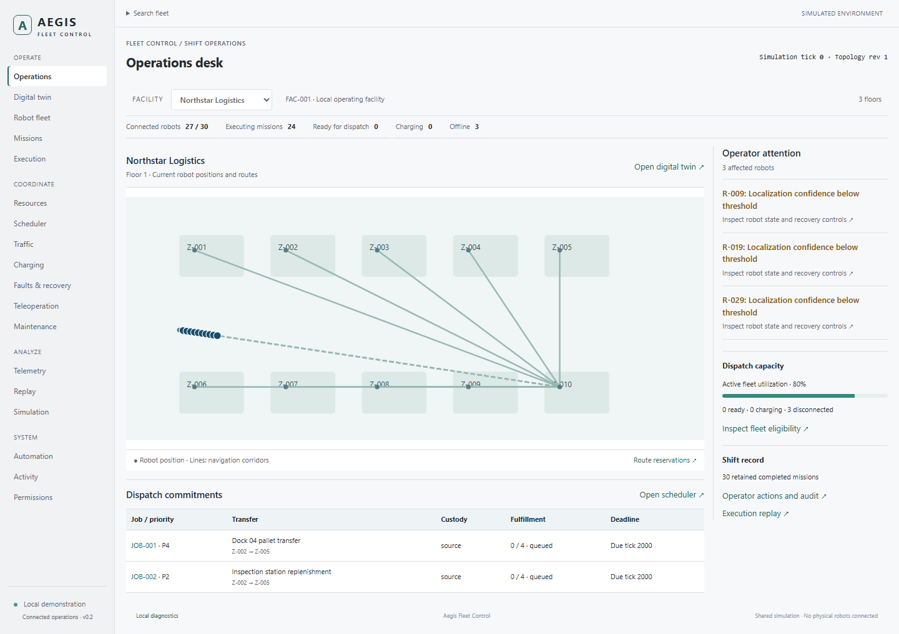

<p align="center">
  
</p>

<p align="center"><strong>Connected fleet operations and mission coordination.</strong></p>

<p align="center"><a href="#overview">Overview</a> · <a href="#explore">Explore</a> · <a href="#getting-started">Getting started</a></p>

<p align="center"><code>React</code> · <code>TypeScript</code> · <code>Vite</code></p>

## Overview

**Aegis Fleet Control** is a self-contained React application for exploring connected robot-fleet operations in a simulated environment.

**Repository:** `aegis-fleet-control` · **Application name:** Aegis Fleet Control. The application branding and code are unchanged.



*Actual application capture using local fixture data.*

## AI code review and regression testing

I have used Aegis Fleet Control to evaluate AI-generated changes, correct bugs, and design benchmarks and tests for connected TypeScript state transitions. The fleet simulation creates concrete cases where one command affects missions, resources, permissions, and persisted history.

- **Asynchronous bug reproduction:** used a manual scheduler and controlled response order to check that late validation cannot overwrite the result for a newly edited mission draft. [Validation-race regression](src/features/missions/ValidationRace.test.tsx)
- **Persistence and recovery tests:** checked schema migration, stale-instance writes, corrupt snapshots, and storage failures that must leave canonical state and subscribers unchanged. [Storage tests](src/storage/PersistentStorageAdapter.test.ts)
- **Authorization and audit review:** tested facility-scoped commands, captured actor grants, immutable before/after history, and failure paths that must not create a successful audit record. [Permissions and audit tests](src/gateway/PermissionsAudit.test.ts)

These behaviors inform debugging-task design and review of candidate patches and tests. This remains a local simulation with browser snapshot persistence; its role selector is not a production authentication service.

After following the documented setup, run the existing verification commands:

```sh
npm run typecheck
npm run lint
npm test
npm run build
npx playwright install chromium
npm run test:e2e
```

The public suites cover domain behavior, rendered interactions, and Chromium journeys.

## Explore

- Fleet overview and facility map
- Missions and execution
- Traffic and resource reservations
- Charging and fault recovery
- Telemetry, replay, and simulation
- Role-aware operational commands

## Getting started

Node.js requirement: `>=20.19.0 <21`. Use the package manager specified in [package.json](package.json).

```bash
git clone https://github.com/Akrambadr99/aegis-fleet-control.git
cd aegis-fleet-control
npm ci
npm run dev
```

Open the URL printed by the development server.

### Development commands

| Command | Script defined by this project |
| --- | --- |
| `npm run dev` | `vite --host 127.0.0.1` |
| `npm run typecheck` | `tsc --noEmit` |
| `npm run lint` | `eslint .` |
| `npm run test` | `vitest run` |
| `npm run test:e2e` | `playwright test` |
| `npm run build` | `tsc --noEmit && vite build` |

See the project guide below for browser installation and any service-specific setup.

<details>
<summary><strong>Project guide, technical details, and existing documentation</strong></summary>

# Aegis Fleet Control

A self-contained React 19 robotics operations platform built in coherent, tested milestones.

## Current delivery

The foundation now runs on one normalized, versioned in-memory fleet gateway. The overview, fleet table, facility map, traffic, charging, faults, mission execution, telemetry, activity, replay events and scenario inputs observe the same confirmed records.

Implemented cross-domain workflows:

- Close a corridor: update topology, invalidate affected routes, pause running missions, hold reservations, record activity/replay and change scenario inputs.
- Recalculate a route: choose an available transfer lane, update reservation and mission estimates, then explicitly resume if readiness permits.
- Disable a charger: displace reservations, expose robot warnings and update mission feasibility and scenario capacity.
- Emergency stop: latch robot stop, pause its mission, release traffic reservations, revoke an existing control lease and record a replay frame.
- Pause selected robots: independent per-robot success/failure results while filters and selection remain usable.
- Acknowledge faults: record operator identity while retaining the recovery safety block.
- Advance the deterministic simulation: update positions, battery, mission progress, telemetry and completion/battery-reserve events.

The seed contains 4 facilities, 12 floors, 120 zones, 120 robots, 240 missions, 36 chargers, 36 reservations, 12 faults, 600 telemetry samples and 240 activity events.

## Run locally

Use Node **20.19.5** and npm **10.8.2**.

```sh
npm ci
npm run dev
```

No external database, service, credentials or API keys are required. Package and browser installation require internet access; the running application does not.

## Validation

```sh
npm run typecheck
npm test
npm run build
npx playwright install chromium
npm run test:e2e
npm run format:check
```

The root test command is directly `vitest run`. Chromium journeys start their own local server on port 4173. The production output is `dist/`; static hosting needs an `index.html` route fallback.

## Try an interconnected workflow

1. Open `/traffic?robot=R-004`.
2. Close C-001 and observe the mission pause and held/invalid reservation.
3. Recalculate the robot's route.
4. Open Execution from the sidebar and explicitly resume M-004.
5. Inspect Activity, Replay or the facility map. The same robot and facility remain selected.

R-004 starts with 53% battery and can take the 130 m detour while retaining the 20% reserve. R-001 starts with 32% and correctly remains paused: that detour requires 15.6 percentage points of energy plus the reserve. These initial batteries are unchanged.

Open `/charging?robot=R-001` and disable CHG-001 to see its reservations displaced and the robot's feasibility warning update.

The role selector is an explicit local simulation feature. The gateway checks role eligibility on every command. This is not a production authentication system.

## Current boundaries

This is an interconnected implementation with a substantial development program still ahead. Routing uses a facility navigation graph. Mission graph editing, saved revisions, templates, typed facility-resource steps, reservation arbitration, teleoperation leases, historical playback and event-driven automation are implemented. Advanced scheduling, cooperative execution, charging progression, configuration, comparative scenarios and the remaining expansion phases still require work. Simulation is stepped manually; optimistic editing has not been introduced.

Operational state is stored as a versioned browser snapshot and survives a full reload. Snapshot restoration runs deterministic schema migrations and rejects corrupt or unsupported data instead of silently replacing it. URL context also survives reload. Telemetry retains a bounded live window; activity and command replay frames retain persisted history.

See [architecture](docs/architecture.md), [milestones](docs/milestones.md), [validation](docs/validation.md), and the original [product brief](docs/product-brief.md).

The [development program checkpoints](docs/program-progress.md) record current phase scope, measured repository size, commits and validation results. Earlier milestone documents retain historical context.

## Scoped control and audit history

Use **Control scope** to grant command access to one facility while retaining read access to the others. Role and facility eligibility are enforced by the gateway as well as visible controls. Commands keep the actor grant captured when issued.

After a command, open **Activity** and expand **Inspect changes** to review immutable before/after records for affected robots, missions, routes and facility resources.

Changes are delivered as coherent commits after typecheck, tests, build and diff review. Read-only actions do not generate filler commits. See the expanded [product requirements](docs/expansion-brief.md).

</details>

---

<p align="center"><a href="https://github.com/Akrambadr99?tab=repositories">Explore the portfolio</a></p>
